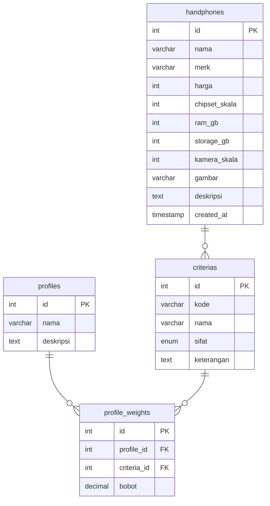

# RANCANGAN DATABASE
## Sistem Pendukung Keputusan Pemilihan Handphone (Metode SAW)

---

### 1. Analisis Kebutuhan Data
Berdasarkan *Project Brief*, *Agents Rules*, dan *Metodologi SAW*, sistem memerlukan penyimpanan data untuk mendukung fungsionalitas berikut:
* **Manajemen Alternatif Handphone:** Menyimpan daftar handphone beserta spesifikasi dan nilai atribut kriteria (Harga, Chipset, RAM, Storage, Kamera).
* **Kriteria Penilaian:** Menyimpan daftar 5 kriteria SAW beserta sifatnya (Cost / Benefit).
* **Profil Kebutuhan & Bobot:** Menyimpan data profil preferensi pengguna (Gaming, Fotografi, Harian) beserta bobot masing-masing kriteria yang berjumlah total 1,00 (100%).
* **Proses Perhitungan SAW:** Mendukung query penyaringan berdasarkan anggaran (*pre-filtering*) serta pengambilan data nilai kriteria untuk normalisasi dan perhitungan nilai preferensi ($V_i$).

---

### 2. Rekomendasi Tabel dan Fungsinya
Untuk menjaga kesederhanaan dan meningkatkan fleksibilitas, database dirancang dengan 4 tabel utama yang esensial:

1. **`handphones` (Alternatif):** Menyimpan data spesifikasi handphone dan nilai kriteria untuk perhitungan SAW.
2. **`criterias`:** Menyimpan daftar kriteria penilaian (C1 s.d. C5) beserta sifat kriteria (Cost/Benefit).
3. **`profiles`:** Menyimpan data profil pengguna (Gaming, Fotografi, Harian).
4. **`profile_weights`:** Menyimpan hubungan bobot antara profil dan kriteria (tabel relasi many-to-many).

---

### 3. Struktur Tabel & Atribut (MariaDB / MySQL)

#### 3.1 Tabel `handphones`
Menyimpan informasi alternatif handphone dan nilai kriteria yang telah dikonversi ke skala penilaian SAW.

| Kolom | Tipe Data | Panjang / Constraint | Keterangan |
| :--- | :--- | :--- | :--- |
| `id` | INT | PK, Auto Increment | ID unik handphone |
| `nama` | VARCHAR | 100, Not Null | Nama lengkap handphone (Contoh: Samsung Galaxy A54) |
| `merk` | VARCHAR | 50, Not Null | Merek / brand handphone (Contoh: Samsung, Xiaomi) |
| `harga` | INT | Not Null | Harga handphone dalam Rupiah (Kriteria C1 - Cost) |
| `chipset_skala` | INT | Not Null (1-5) | Nilai skala performa chipset (Kriteria C2 - Benefit), dinilai manual oleh admin |
| `ram_gb` | INT | Not Null | Kapasitas RAM fisik dalam GB (untuk perhitungan skala otomatis C3) |
| `storage_gb` | INT | Not Null | Kapasitas penyimpanan dalam GB (untuk perhitungan skala otomatis C4) |
| `kamera_skala` | INT | Not Null (1-5) | Nilai skala kualitas kamera (Kriteria C5 - Benefit), dinilai manual oleh admin |
| `gambar` | VARCHAR | 255, Null | Nama file gambar / URL foto handphone |
| `deskripsi` | TEXT | Null | Penjelasan singkat atau spesifikasi tambahan |
| `created_at` | TIMESTAMP | Default CURRENT_TIMESTAMP | Waktu data ditambahkan |

*(Catatan: `ram_skala` dan `storage_skala` dihapus karena nilainya dapat dihitung secara otomatis dari `ram_gb` dan `storage_gb` saat proses perhitungan SAW di aplikasi PHP)*

#### 3.2 Tabel `criterias`
Menyimpan referensi 5 kriteria utama metode SAW.

| Kolom | Tipe Data | Panjang / Constraint | Keterangan |
| :--- | :--- | :--- | :--- |
| `id` | INT | PK, Auto Increment | ID unik kriteria |
| `kode` | VARCHAR | 5, Not Null, Unique | Kode kriteria (C1, C2, C3, C4, C5) |
| `nama` | VARCHAR | 50, Not Null | Nama kriteria (Harga, Chipset, RAM, Storage, Kamera) |
| `sifat` | ENUM | ('Cost', 'Benefit'), Not Null | Sifat kriteria untuk rumus normalisasi |
| `keterangan` | TEXT | Null | Penjelasan tambahan mengenai kriteria |

#### 3.3 Tabel `profiles`
Menyimpan profil prioritas kebutuhan pengguna.

| Kolom | Tipe Data | Panjang / Constraint | Keterangan |
| :--- | :--- | :--- | :--- |
| `id` | INT | PK, Auto Increment | ID unik profil |
| `nama` | VARCHAR | 50, Not Null, Unique | Nama profil (Gaming, Fotografi, Harian) |
| `deskripsi` | TEXT | Null | Deskripsi singkat fokus profil kebutuhan |

#### 3.4 Tabel `profile_weights` (Relasi Many-to-Many)
Menyimpan bobot setiap kriteria untuk setiap profil (relasi between `profiles` dan `criterias`).

| Kolom | Tipe Data | Panjang / Constraint | Keterangan |
| :--- | :--- | :--- | :--- |
| `id` | INT | PK, Auto Increment | ID unik record bobot |
| `profile_id` | INT | FK → `profiles.id` | Referensi ke profil |
| `criteria_id` | INT | FK → `criterias.id` | Referensi ke kriteria |
| `bobot` | DECIMAL | 3,2, Not Null | Nilai bobot kriteria untuk profil (0.00 - 1.00) |

*(Catatan: Untuk setiap profil, jumlah bobot dari semua kriteria harus persis 1.00 (100%))*

---

### 4. Hubungan Antar-Tabel (Relasi)

* Tabel **`criterias`** menyimpan definisi kriteria yang bersifat statis dan menjadi referensi untuk perhitungan SAW.
* Tabel **`profiles`** menyimpan data profil kebutuhan tanpa menyimpan bobot secara langsung.
* Tabel **`profile_weights`** bertindak sebagai tabel relasi yang menghubungkan setiap profil dengan kriteria, dan menyimpan bobot spesifik untuk kombinasi profil-kriteria tersebut (relasi many-to-many).
* Tabel **`handphones`** berisi data alternatif yang diolah secara independen dan diakses sesuai dengan kriteria yang tersedia di tabel `criterias`.
* Ketika pengguna memilih profil untuk perhitungan SAW, sistem mengambil bobot dari tabel `profile_weights` berdasarkan kombinasi `profile_id` dan `criteria_id`.

---

### 5. Rancangan ERD (Entity Relationship Diagram)
Berikut adalah rancangan ERD dalam format Mermaid:

---

### 6. Dukungan terhadap Kriteria SAW dan Profil Kebutuhan

* **Dukungan 5 Kriteria SAW:**
  * Kriteria **C1 (Harga)** disimpan dalam kolom `harga` tabel `handphones` (sifat Cost).
  * Kriteria **C2 (Chipset)** disimpan dalam kolom `chipset_skala` tabel `handphones` (sifat Benefit) - dinilai manual.
  * Kriteria **C3 (RAM)** dihitung dari kolom `ram_gb` tabel `handphones` menjadi skala 1-5 saat proses normalisasi (sifat Benefit).
  * Kriteria **C4 (Storage)** dihitung dari kolom `storage_gb` tabel `handphones` menjadi skala 1-5 saat proses normalisasi (sifat Benefit).
  * Kriteria **C5 (Kamera)** disimpan dalam kolom `kamera_skala` tabel `handphones` (sifat Benefit) - dinilai manual.

* **Dukungan 3 Profil Kebutuhan:**
  * Profil **Gaming**, **Fotografi**, dan **Harian** disimpan dalam tabel `profiles`.
  * Masing-masing profil memiliki bobot untuk 5 kriteria yang disimpan dalam tabel `profile_weights`.
  * Jumlah bobot setiap profil harus persis 1.00 (100%).

---

### 7. Alasan Perubahan Desain

**Dari 3 Tabel Menjadi 4 Tabel:**
* Pemisahan tabel `criterias` dan `profiles` meningkatkan fleksibilitas dan normalisasi database.
* Tabel `profile_weights` sebagai relasi many-to-many memungkinkan manajemen bobot yang lebih terstruktur dan mudah diperluas untuk profil tambahan di masa depan.

**Penghapusan `ram_skala` dan `storage_skala`:**
* Nilai skala RAM dan Storage dapat dihitung secara otomatis dari kapasitas fisik (`ram_gb` dan `storage_gb`) menggunakan logika di aplikasi PHP.
* Ini mengurangi duplikasi data dan memudahkan pembaruan di masa depan.

**Penyimpanan Manual `chipset_skala` dan `kamera_skala`:**
* Kedua nilai ini tidak dapat dihitung otomatis karena memerlukan evaluasi kualitatif oleh admin.
* Chipset performance dan kualitas kamera merupakan penilaian subjektif yang perlu dinilai secara manual.

---

### 8. Catatan Diskusi & Keputusan Belum Jelas

1. **Penyimpanan Riwayat Pencarian (*History*):** Saat ini diputuskan untuk **tidak** membuat tabel riwayat pencarian atau log rekomendasi pengguna guna menjaga kesederhanaan proyek tahap awal (sesuai prinsip *keep it simple*). Fitur riwayat dapat dipertimbangkan kembali pada pengembangan lanjutan jika diperlukan.

2. **Validasi Jumlah Bobot:** Penjumlahan bobot per profil (yang harus = 1.00) perlu divalidasi di sisi aplikasi saat data dikelola di admin panel.
